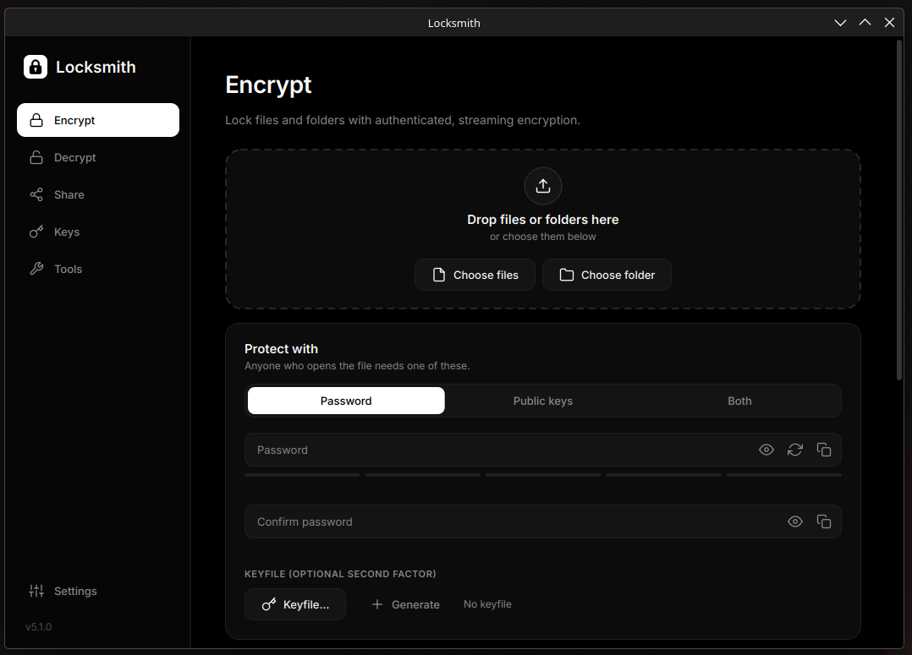

# Locksmith



Locksmith is a black-and-white desktop app that encrypts, decrypts and shares files on Linux and
Windows. You build it as one AppImage or one Windows `.exe`.

> **Status:** Locksmith has not had an independent audit. AI-assisted review, tests, fuzzing and
> published test vectors make mistakes less likely, but they cannot prove that there are no mistakes.
> Keep a second backup of all data that you must not lose.

## Features

- **Strong encryption:** AES-256-GCM, ChaCha20-Poly1305, AES-256-GCM-SIV, AES-256-OCB3, AES-256-SIV,
  or a cascade of two or three ciphers.
- **Flexible access:** a password, a keyfile, public keys for one or more recipients, or a
  combination. You can change the access later without encrypting the data again.
- **Post-quantum keys:** new identities use X25519 + ML-KEM-768 to encrypt and Ed25519 + ML-DSA-65 to
  sign.
- **Private by default:** size padding, decoy recipient slots and padded metadata. Hidden file names
  and removal of photo metadata are also available.
- **Signatures:** sign a file inside its encryption, or make a detached `.lsig` file. Locksmith also
  verifies minisign, SSH and OpenPGP signatures.
- **Compatible:** SSH and age keys can be recipients. Locksmith reads and writes `.age` files.
- **Key backups:** backup words, Shamir shares, printable paper backups and TPM sealing.
- **Share and tools:** email, pasteable text, split files, encrypted messages, checksums, a password
  generator, recovery data for damaged storage and a shredder.

[docs/FEATURES.md](docs/FEATURES.md) gives the full list.

## Build

On Linux (x86_64 or aarch64), with `curl`, `tar`, `xz` and binutils:

```sh
./packaging/build_appimage.sh
./dist/Locksmith-x86_64.AppImage
```

For Windows, on Linux with 64-bit Wine:

```sh
./packaging/build_windows.sh
```

The AppImage runs on Linux with glibc 2.34 or later. The `.exe` runs on Windows 10 1903 or later.
[docs/BUILD.md](docs/BUILD.md) gives the full instructions and the development setup.

## Important limits

- If you lose the password, the keyfile or the private key, you lose the data. Recovery is not
  possible.
- A new password or new recipients do not remove access. To remove access, decrypt the file and
  encrypt it again.
- An unsigned file does not show who made it. Sign a file to show that you made it.
- Some data about a file is not encrypted, for example the cipher suite and the number of key slots.
- Backup words, Shamir shares, paper backups and unprotected backup files contain the private key.
  Keep them safe.

[docs/SECURITY_MODEL.md](docs/SECURITY_MODEL.md) gives all the limits and the protections.

## Documentation

| Document | Contents |
|----------|----------|
| [docs/FEATURES.md](docs/FEATURES.md) | All the features |
| [docs/BUILD.md](docs/BUILD.md) | Build, check and develop, and the differences on Windows |
| [docs/SECURITY_MODEL.md](docs/SECURITY_MODEL.md) | How a file is protected, what is visible, runtime protection, limits |
| [docs/FORMAT.md](docs/FORMAT.md) | The file format specification, with test vectors in [tests/vectors](tests/vectors) |
| [SECURITY.md](SECURITY.md) | How to report a vulnerability |

## License

Copyright (C) 2026 willbara. Locksmith is free software: you can redistribute it and/or modify it under the
terms of the [GNU General Public License version 3](LICENSE) as published by the Free Software Foundation.
It is distributed in the hope that it will be useful, but WITHOUT ANY WARRANTY. If you distribute Locksmith
or a modified version of it, you must provide its source code under the same license.

The bundled Inter font keeps its own license (SIL OFL 1.1, `locksmith/assets/fonts/Inter-LICENSE.txt`).
