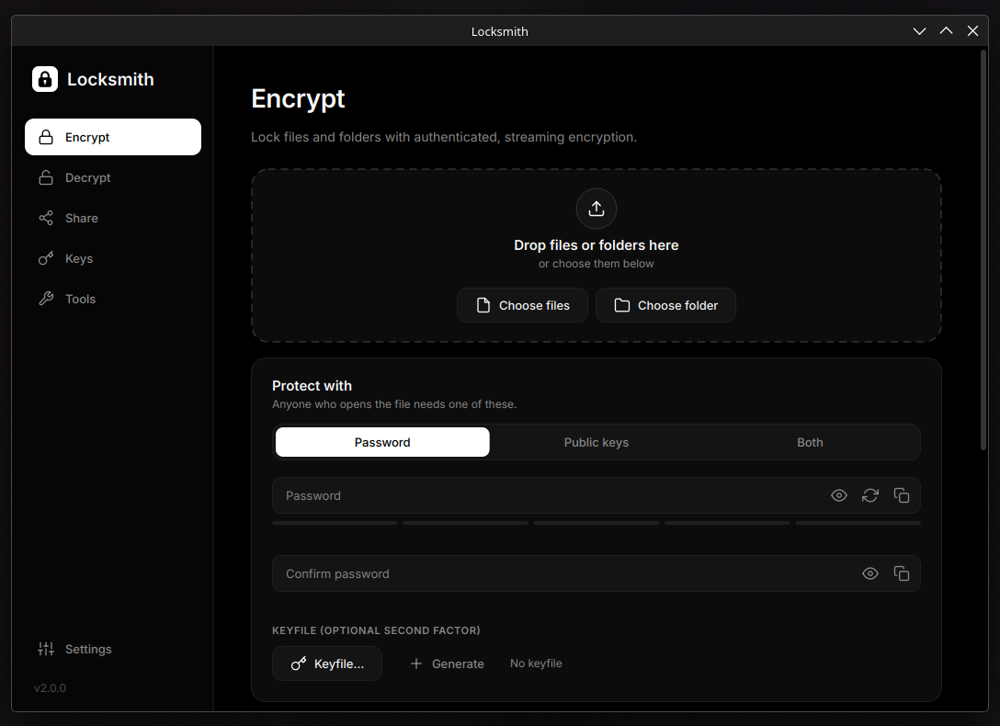

# Locksmith



A minimalist black-and-white desktop app to encrypt, decrypt and share files on Linux and Windows.
Build it yourself as a single AppImage or a single Windows .exe.

> **Status:** Locksmith has not been independently audited. It was built with AI-assisted review, and is
> checked by its tests, fuzzing and published test vectors, which reduce the risk of mistakes but can't rule
> them out. Don't let a Locksmith file be the only copy of data you can't afford to lose: keep another
> backup.

## Build

Needs `curl`, `tar`, `xz` and binutils (`ar`, `objdump`), plus internet access on the first build. No system
Python is needed.

```sh
./packaging/build_appimage.sh
./dist/Locksmith-x86_64.AppImage
```

The script downloads pinned, checksum-verified tools into `build/` (uv, a standalone Python 3.14, appimagetool),
installs dependencies from the hash-locked `packaging/requirements.lock`, runs the tests, freezes the app with
PyInstaller, refuses to package if anything would need a newer system than the targets below, and finally runs
the AppImage's self-test. Set `SKIP_TESTS=1` to skip the tests and the self-test. Works on x86_64 and aarch64.

**Compatibility:** the AppImage runs on any Linux with glibc 2.34+ and a standard desktop: Ubuntu 22.04+,
Debian 12+, Linux Mint 21+, Fedora 35+, RHEL/Rocky/Alma 9+, Arch. On older systems it exits with a clear
message. `./packaging/test_distros.sh` checks this in podman containers of several distros.

**Reproducible:** the same source and pinned inputs give a byte-identical AppImage;
`./packaging/check_reproducible.sh` builds twice and compares.

**Check a build:** `./dist/Locksmith-x86_64.AppImage --self-test` round-trips every cipher, compression method and
key-derivation function, checks public-key encryption and memory protection, and builds the window offscreen.
It uses a throwaway config and never touches your keys.

Files passed on the command line, or dropped anywhere on the window, are routed automatically: `.locked`
files go to Decrypt, everything else to Encrypt.

## Build for Windows

```sh
./packaging/build_windows.sh      # on Linux; needs wine (64-bit), curl, python3
```

Produces `dist/Locksmith-windows-x64.exe` (one file, runs on Windows 10 1903+ and 11) plus a `.sha256`
file to send with it. The script uses the real Windows builds of Python 3.14, Qt, `cryptography` and
PyInstaller, pinned and hash-verified like the Linux build. Wine only hosts the build: it runs the test suite
with Windows Python, then the `.exe`'s self-test. Wine lacks the ICU library that Windows provides, so the
build installs a small stand-in into its own Wine prefix (never into the `.exe`).

Files are fully compatible between the Windows and Linux versions. Differences on Windows:

- **Protections:** only those that can be applied and verified are attempted. DLL-injection protection (process
  mitigation policies, read back after being set) and keeping copied secrets out of clipboard history.
  Crash-dump and memory-reading protection and the network block have no reliable unprivileged equivalent
  and are shown as unavailable in Settings → About. TPM sealing is shown greyed out as not available.
- **Email** opens a new message and shows the file in Explorer to attach (Windows has no standard way to
  attach automatically). Settings and keys live in `%LOCALAPPDATA%\locksmith` (the local profile,
  which doesn't roam); Locksmith 4 kept them in `%APPDATA%` and they are moved on first start.
- **Sharing the .exe:** it is not code-signed, so Windows SmartScreen warns on first run ("More info → Run
  anyway"). Check the SHA-256 against the `.sha256` file you sent alongside it.

## Develop

```sh
python3 -m venv .venv        # Python 3.12.11+ (or 3.13.4+); older than 3.14 installs backports.zstd automatically
.venv/bin/pip install -e ".[dev]"
.venv/bin/python run.py      # run from source
.venv/bin/pytest             # tests
.venv/bin/ruff check         # lint
LOCKSMITH_FUZZ=20000 .venv/bin/pytest tests/test_fuzz.py   # a longer fuzzing run
```

```
locksmith/
  core/      encryption engine, no Qt: ciphers, KDFs, compression, file format, keys, tools
  ui/        PySide6 interface: theme, custom widgets, dialogs, worker threads, pages/
  assets/    app icon and bundled Inter font (OFL, see fonts/Inter-LICENSE.txt)
packaging/   build script, PyInstaller spec, dependency lock, distro tests, .desktop file, MIME type
tests/       tests, fuzzing (test_fuzz.py) and format test vectors (vectors/)
docs/        file-format specification
```

## Features

- **Ciphers:** AES-256-GCM, ChaCha20-Poly1305, AES-256-GCM-SIV, AES-256-OCB3, AES-256-SIV, and cascades
  (AES + ChaCha20, AES + ChaCha20 + OCB3) with an independent key per layer.
- **Key derivation:** Argon2id, scrypt or PBKDF2-SHA512, with four strength presets (Fast → Paranoid).
- **Protection:** a password, a keyfile (second factor), public keys for any number of recipients, or any
  combination. Each one wraps the same random file key, so the password, keyfile and recipients can be
  changed later without encrypting the data again (Decrypt → Change who can open it). That doesn't take
  access away from anyone who could already open the file; encrypting it again does.
- **Keys:** identities (your key pairs) and contacts (other people's public keys). New identities are hybrid
  post-quantum (X25519 + ML-KEM-768) and can sign files (Ed25519 + ML-DSA-65); older classical ones can be
  upgraded. An identity can be protected
  with a passphrase, sealed to the machine's TPM, exported as a backup, written down as backup words, split
  into Shamir shares, saved as a printable paper backup (QR code and words, restored by photographing
  or scanning the page), and shared as text or a QR code. Recipients aren't named in the file: it
  doesn't list whose keys can open it, and decoy slots can hide how many recipients there are. A signed
  file is addressed to its recipients by default, so a reader can tell whether they were one of them.
- **SSH and age keys:** SSH Ed25519 and RSA public keys can be recipients, and the SSH private key opens
  the file (passphrase-protected keys too). age keys (`age1…`, `age1pq1…`, `AGE-SECRET-KEY-…`) can be
  added as contacts or restored as identities.
- **age files:** encrypt to and decrypt `.age` files (age-encryption.org/v1), including age's
  post-quantum recipients, so files can be exchanged with age and rage. Checked against the age
  authors' test kit.
- **Privacy:** optional lossless removal of photo metadata (JPEG, PNG, WebP: location, camera, dates) and
  file times. Folder archives never record user or group names. Text messages are padded, not compressed.
- **Extras:** streaming chunked encryption with parallel per-chunk compression (Zstandard, zlib, LZMA,
  bzip2, or automatic), size padding (Padmé, block or power-of-two), hidden file names, encrypted notes,
  folders and multi-item bundles, ASCII armor, verify-only mode, shredding of originals.
- **Share:** copy a file to the clipboard, email it, copy it as pasteable text, split it into size-limited
  parts and join them, send encrypted text messages, show a password as a QR code, split a password among
  people with Shamir secret sharing, publish your public key.
- **Tools:** password and passphrase generator, strength tester, checksums, file comparison, folder
  manifests (`sha256sum --tag` compatible), detached signatures (sign and verify, `.lsig`), minisign, SSH
  (`ssh-keygen -Y sign`) and OpenPGP (GnuPG `.sig`/`.asc`, against one public key, no keyring) signature
  verification, recovery data (`.lpar`) that repairs files damaged by failing storage, keyfile generator,
  shredder.
- **Desktop integration:** Settings → Desktop integration opens `.locked` files with Locksmith and adds
  "Encrypt with Locksmith" to the right-click menu of GNOME Files, Dolphin, Nemo and Windows Explorer.
- **Interface:** dark, light or system theme, monochrome throughout.

## File format

```
"LOCKED\x00\x02" | key commitment | u32 len | fixed header JSON | u32 len | key slots JSON | { u32 len | AEAD frame }*
```

The full specification is [docs/FORMAT.md](docs/FORMAT.md), with test vectors in
[tests/vectors](tests/vectors).

This is format version 2. Files in version 1 (Locksmith 2.x) are still read. Locksmith 2.0 replaced the
format of Cryptor 1.x (the app's former name); Cryptor files and keys are not read.

- A random 256-bit data key (DEK) is wrapped with AES-256-GCM once per slot. A password slot uses KDF
  output, mixed with SHA-512(keyfile) through HKDF when a keyfile is set. A classical recipient slot uses
  an ephemeral X25519 exchange plus HKDF. A hybrid slot also
  encapsulates to the recipient's ML-KEM-768 key and derives its key from both shared secrets plus the
  transcript, so breaking X25519 alone is not enough.
- Layer keys, the metadata key and a key commitment are derived from the DEK with HKDF-SHA512. The
  commitment also covers the fixed header (cipher, chunk size, nonce prefix, salt, metadata), so changing
  any of it makes the file refuse to open. A slot only counts as opened when its key matches the
  commitment; a mismatch reads as a wrong key.
- Frame `i` uses nonce `prefix(7) ‖ i(u32) ‖ final(u8)` and the SHA-256 of the fixed header as associated
  data. Reordering, truncation, appended data and header tampering all fail authentication. The key slots
  are bound only to the DEK, so they can change without re-encrypting the data.
- File name, size, type, compression method and note are stored in an encrypted metadata blob.
- A file can be signed (Encrypt → Sign as). The Ed25519 + ML-DSA-65 signature sits inside the encryption,
  after the content, and covers the fixed header and the content but not the key slots. A file whose
  signature doesn't verify is refused and nothing of it is written.
- Output is written to a temporary file and moved into place only after every frame authenticates.

## Runtime protection

These are settings the process applies to itself at start-up. Settings → About shows which ones this
system accepted. They narrow what other programs can reach; they don't defend against root, the kernel
or malware that already controls your account.

- **Memory:** the process is configured to disable core dumps and to be non-dumpable, so a crash shouldn't
  write keys to disk and other programs running as you are refused access to its memory. Python can't
  reliably erase secrets from memory once they are used, so this keeps that memory inside the process
  rather than wiping it.
- **No network:** a seccomp filter on every thread is configured to refuse creating any internet or other
  non-local socket. Programs it opens (file manager, mail) are started by systemd, outside the sandbox.
  This keeps Locksmith from reaching the network by mistake. It is not a sandbox against a compromised
  Locksmith: local (Unix) sockets stay open, so code running inside it could ask systemd to start a program
  that has network access.
- **Auto-lock and panic:** after inactivity (default 10 minutes), or with Ctrl+L, secrets are removed from
  the window and it is covered. Ctrl+Shift+L also minimizes it. A task that finishes while locked doesn't
  show its secret result; after unlocking, you're told to open it again. The lock is a privacy screen, not
  a password lock: any click or key brings the window back, and identities without a passphrase can
  still be used. Give your identities a passphrase if someone else may use your computer.
- **Clipboard:** copied passwords and decrypted text are marked so clipboard managers skip them, and cleared
  after 30 seconds, on lock and on quit.

The desktop portal refuses requests from a non-dumpable process, so Locksmith uses its own file dialogs and
reads the system dark/light setting through a short-lived helper process. Settings → About shows the status.

## Your data

Settings and keys live in `~/.config/locksmith/` (`keys.json` is mode 0600). Identities can optionally be
protected with a passphrase (Argon2id + AES-GCM).

## Caveats

- Shredding is best effort. SSDs and copy-on-write filesystems such as btrfs can keep old copies.
- Locksmith 5 writes Shamir shares that Locksmith 4 and earlier can't combine (they now hide the secret's
  length). On Windows, keys and settings move from `%APPDATA%` to `%LOCALAPPDATA%` the first time
  Locksmith 5 starts, after which Locksmith 4 no longer finds them. Files and public keys are unchanged.
- TPM sealing keeps a copied disk or backup from using an identity. On this machine, any program running as
  you can still ask the TPM to unseal it, unless the identity also has a passphrase.
- On X11, every program on the display can read what you type, passwords included. Wayland doesn't allow
  this; Settings → About says which one is in use.
- Losing the password, keyfile or private key means losing the data. There is no recovery.
- Changing a file's password or recipients doesn't revoke access: anyone who opened it before may have
  kept its file key. To take access away, decrypt it and encrypt it again.
- SSH keys and classical age keys are not post-quantum. A file with an SSH RSA recipient can't be opened
  by Locksmith 3.0 or earlier at all.
- Unsigned files are not authenticated. Decrypting proves a file was not changed after it was made, not
  who made it: anyone with your public key can send you a file, and its name and note can claim anything.
  To show who made a file, sign it (Encrypt → Sign as, or a detached `.lsig` from Tools). A valid signature
  means "signed with the key you saved as X", which is only as good as your fingerprint check: a contact
  counts as checked only once you enter the fingerprint they gave you over another channel (Keys → the
  fingerprint button). It says who signed the content, not whom it was sent to: anyone who can open a signed
  file can pass it on, still signed. Files signed for public-key recipients list them by default, so a
  passed-on copy says its reader wasn't on the list; one without a list says so too.
- On Windows, decrypted files keep the Mark of the Web of the encrypted file. When it has none, programs,
  scripts and macro documents inside are marked as downloaded from the internet, unless the file was signed
  by you or by a contact whose fingerprint you checked.
